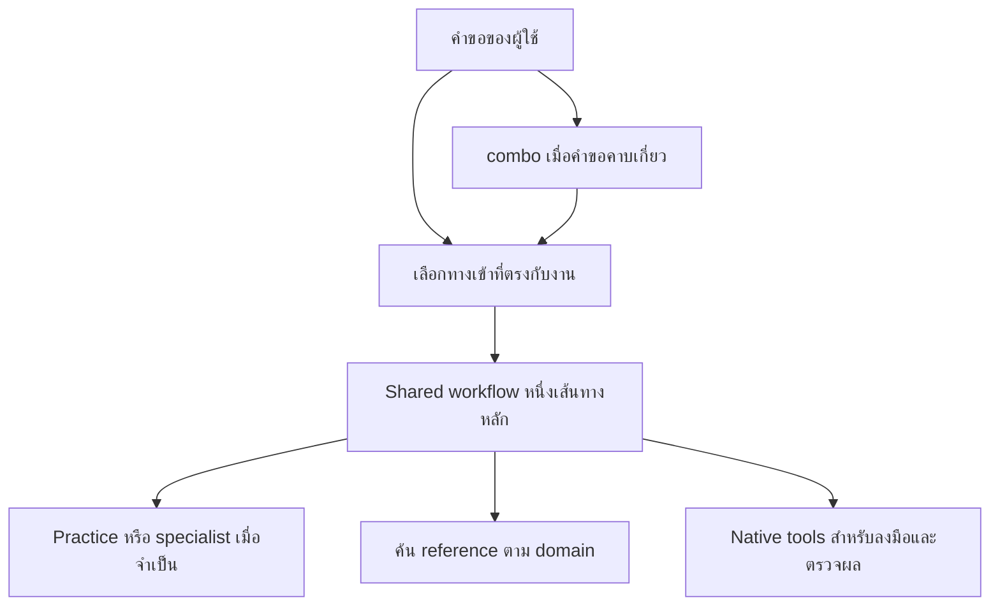

# Combo สำหรับ Codex และ Claude Code

Workflow pack ที่ออกแบบการทำงานร่วมกันใหม่จาก **Karpathy, Ponytail, Matt Pocock
และ ECC** ครอบคลุมทั้ง engineering และงานนอก coding

เลือกโครงสร้าง **12 ทางเข้าตามงาน + `combo` router + `combo-maintain`**
ทุกทางเข้าใช้ workflow และ library ร่วมกัน อ่านเฉพาะส่วนที่ต้องใช้
รายละเอียดการเลือกและผลทดสอบอยู่ใน [รายงาน A/B](audit/ab/DECISION.md)

**ปรับ context และ output (14 กันยายน 2026):** ทุก workflow ใช้
[กฎเลือกหลักฐานร่วม](skills/combo/practices/context.md) เพื่ออ่านตามคำถามที่มีผลต่อ
การตัดสินใจ รักษา contract และข้อขัดแย้ง ใช้ผลตรวจที่ยัง valid และรายงานเฉพาะ
ผลกับหลักฐานที่จำเป็น โดยคงความลึกและ coverage ที่ผู้ใช้ขอ
ดู [ผลตรวจรอบนี้](audit/context-20260914/REPORT.md) และ
[โจทย์ context probes](evals/context/README.md)

**ติดตั้งใน Codex และตรวจแล้ว (10 กันยายน 2026):** discovery ครบ 14 entries,
ไฟล์ตรงกับ source และซ้อม rollback ผ่าน โดย config ส่วนอื่นและ M2D คงเดิม

**Claude Code ติดตั้งแล้วเช่นกัน:** ปรับเป็น native Skill/Plan Mode/subagent,
discovery ครบ 14 entries และทดสอบการเรียกอัตโนมัติใน session จริงแล้ว
ดู [Claude setup](adapters/claude/README.md) และ [ผลตรวจ](audit/claude/REPORT.md)

## ใช้งาน

สั่งงานตามปกติได้ทั้งไทยและอังกฤษ ไม่ต้องจำชื่อ source pack หรือเรียกหลาย skill
ต่อกัน เช่น “แก้บั๊กนี้ให้เสร็จ”, “วางแผนก่อน ยังไม่แก้โค้ด”,
“ทำ brief นี้เป็น LinkedIn กับ email” หรือ “สอนเรื่องนี้พร้อมแบบฝึกหัด”

| งาน | ทางเข้าที่ตรงกับงาน |
| --- | --- |
| พัฒนา feature และ refactor ให้เสร็จ | `combo-deliver` |
| วินิจฉัยหรือซ่อม bug และ build failure | `combo-debug` |
| ออกแบบ requirement, architecture และแผน implementation | `combo-plan` |
| ตรวจ code, requirement และความเสี่ยง | `combo-review` |
| รัน checks หรือทดสอบ user journey | `combo-verify` |
| เข้าใจ code และเปรียบเทียบทางเลือกทางเทคนิค | `combo-investigate` |
| Research หลักฐาน ตลาด และคำถามเชิงวิชาการ | `combo-research` |
| เขียนเนื้อหา วิเคราะห์ voice และดัดแปลงหลายช่องทาง | `combo-content` |
| สอน ออกแบบแบบฝึกหัด บทเรียน และ course | `combo-learning` |
| วิเคราะห์ธุรกิจ การเงิน inventory และ operations | `combo-business` |
| Visual direction, motion, video และ multimedia | `combo-media` |
| จัดงาน triage backlog, handoff และปรับวิธีทำงาน | `combo-productivity` |

เมื่อคำขอคาบเกี่ยวหรือยังเลือกทางไม่ได้ ใช้ [combo](skills/combo/SKILL.md)
เป็น router สำรอง ใน Codex เรียก `$combo` หรือ `$combo-content` โดยตรงก็ได้
ส่วน Claude Code ใช้ `/combo` หรือ `/combo-content`
งานแปลประโยคเดียวและการแก้เล็กที่เข้าใจชัดทำ inline ได้
คำขอที่ให้ทำงานจนเสร็จจะไม่หยุดแค่แผน ส่วน plan-only และ review-only
จะรักษาจุดที่ผู้ใช้ขอให้หยุด

Native skills ยังรับผิดชอบการใช้ browser, เอกสาร, ภาพ, spreadsheet และเครื่องมือ
เฉพาะทาง Combo ช่วยเลือกกระบวนการและความรู้ที่เกี่ยวข้อง

## ข้างในมีอะไร



- [12 workflows](skills/combo/workflows/) เป็นกระบวนการที่ออกแบบให้ทำงานร่วมกัน
- [8 practices](skills/combo/practices/) และ [27 engineering specialists](skills/combo/specialists/INDEX.md) ใช้เพิ่มความลึกเฉพาะเรื่อง
- [Source library](skills/combo/references/library/INDEX.md) เก็บครบ **330 direct source entries** จาก 4 repositories พร้อม support files, source pins และ license notices
- [POLICY.md](POLICY.md) รวมหลัก Karpathy/Ponytail สำหรับ engineering และกติกาเลือก workflow
- [DESIGN.md](DESIGN.md) อธิบายการตัดสินใจของ architecture

330 entries หมายถึงความครอบคลุมของต้นฉบับ ไม่ใช่ 330 integrations ที่รันผ่านแล้ว
ส่วนที่ทับกันถูกจัดเจ้าของใหม่ ส่วน persona, ตัวเลขตัวอย่าง, tracker, hooks,
memory และ installer ของ upstream ต้องปรับให้เข้ากับงานและ host จริง
ไม่มีการเปิดระบบเหล่านี้เพียงเพราะอ่าน reference

ต้นฉบับดึงจาก GitHub และตรึง revision ไว้ใน [sources.lock.json](sources.lock.json)
[Source manifest](curation/full-library.json) ระบุที่มา การจัดกลุ่ม การปรับลิงก์
และ hash ของไฟล์ ไม่ต้องโหลด library ทั้งหมดเข้า context ทุกครั้ง

## Agent หลักและ Luna Max

Agent หลักรับผิดชอบเจตนา workflow, architecture, tradeoffs และการยอมรับผลงาน
เมื่องานเหมาะกับ delegation และได้รับอนุญาต ใช้ `combo_worker` สำหรับงานอิสระ
ที่กำหนดขอบเขตชัด โดย [Codex adapter](adapters/codex/combo-worker.toml)
ตั้งเป็น **Luna Max** ไม่เปลี่ยน model หลักของผู้ใช้

Workflow ไม่มีชื่อ model ฝังอยู่ จึงใช้ร่วมกับ model อื่นได้
ผลทดลองรอบนี้วัด Luna Max เท่านั้น ยังไม่ใช่หลักฐาน auto-trigger ของทุก model

Claude Code ใช้ [native `combo-worker`](adapters/claude/agents/combo-worker.md)
แบบ `model: inherit` ตาม model หลักของ Claude พร้อมส่ง context และขอบเขตงาน
ให้ subagent อย่างชัดเจน ดู [Claude setup](adapters/claude/README.md)

## ผลเปรียบเทียบ

ทดสอบ Codex จริง 10 คู่ รวม 20 sessions และตรวจซ้ำเฉพาะ 2 คู่ที่ติดเวลาหรือ
มีผลต่างที่ต้องแยกสาเหตุ โดยใช้เนื้อหาเดียวกันทั้งสองแบบ
ดู [คำตัดสินพร้อม semantic review](audit/ab/DECISION.md) และ [metrics](audit/ab/metrics.md)

เลือก pack เพราะแบ่งเจตนาของงานได้ชัดและดูแลเนื้อหาร่วมกันได้สะดวก
ไม่ได้เลือกเพราะประหยัดกว่า: 8 คู่ที่จบครบทั้งสองฝั่งในรอบแรกใช้ uncached input
รวม A 214,099 และ B 236,597 tokens ผลเรื่องเวลาและคุณภาพต่างกันตามเคส
การค้นพบ skill ผ่านไม่ได้แปลว่าทุกคำตอบของ model ถูกต้องโดยอัตโนมัติ

## ติดตั้งและดูแล

Codex ใช้คำสั่งด้านล่าง ส่วน Claude Code ใช้
[ตัวติดตั้งและคำแนะนำเฉพาะ Claude](adapters/claude/README.md)
Claude เว็บ/Cowork และ ChatGPT ทั่วไปอยู่นอกขอบเขตการติดตั้งนี้
เปิด task ใหม่เพื่อรับ skill listing และ role ปัจจุบัน หากแอปยังแสดงรายการเก่า
ให้เปิด Codex ใหม่ ทางเข้าทั้งชุดมี `allow_implicit_invocation: true`
และมี global routing policy ประกอบการเลือก

```powershell
python scripts/prepare.py
python scripts/setup.py plan
python scripts/setup.py apply
python scripts/setup.py verify
```

ตัวติดตั้งเก็บ baseline, ownership index และ receipt สำหรับ rollback
แก้เฉพาะ package กับส่วนของ Combo ใน config/AGENTS.md รักษา Preferences,
M2D, hooks, MCP, credentials และ native skills ส่วนอื่น
ใช้ `$combo-maintain` เมื่อจะอัปเดต ตรวจสถานะ หรือย้อนกลับ

Baseline ก่อนขยายอยู่ที่ [archive/v2-engineering](archive/v2-engineering/)
และ receipt เดิมยังเก็บอยู่ การ rollback จะหยุดเมื่อพบไฟล์ถูกแก้ภายหลัง
เพื่อไม่ทับงานใหม่ของผู้ใช้

ย้อนกลับไปก่อนการติดตั้งรอบขยายนี้:

```powershell
python scripts/setup.py rollback --receipt backups/20260909-163949-897900/receipt.json
```

หลักฐาน: [การติดตั้งและ rollback](audit/ab/installation-verification.json),
[การรักษา config และ M2D](audit/ab/preservation.json)
