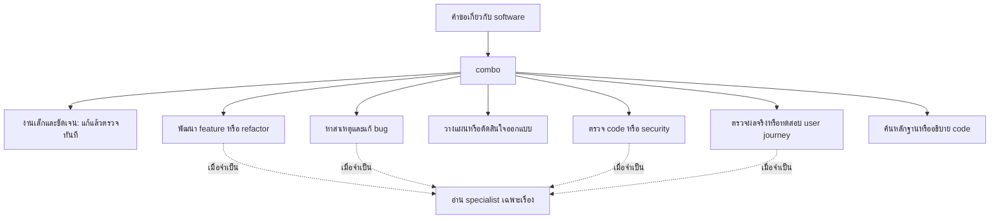

# Combo

ชุด workflow สำหรับ Codex ที่รวม Karpathy, Ponytail, Matt Pocock และ ECC
ให้ทำงานร่วมกัน โดยเลือกขั้นตอนตามงานและอ่านรายละเอียดเฉพาะที่ต้องใช้

**กำลังขยายขอบเขต:** รวมงานนอก coding และทดสอบทางเข้าเดียวเทียบกับ skill pack
ตาม [EXPERIMENT.md](EXPERIMENT.md) และ [EXPANSION.md](EXPANSION.md)
candidate ที่ขยายแล้วอยู่ใน [candidates/common/combo](candidates/common/combo/)
ข้อมูลด้านล่างอธิบาย coding baseline ที่ติดตั้งอยู่ จนกว่าจะเลือกและติดตั้งผลรอบนี้

ติดตั้ง package ใหม่ใน Codex แล้ว: router เดียว, 6 workflows, 8 practices
และ specialist notes 27 เรื่อง ตาม [DESIGN.md](DESIGN.md)
ผลตรวจการติดตั้งอยู่ใน [audit/v2/installation.json](audit/v2/installation.json)

## ผู้ใช้สั่งงาน โมเดลเลือก workflow

สั่งตามปกติได้ทั้งไทยและอังกฤษ ไม่ต้องเลือก pack หรือเรียกหลาย skill ต่อกัน
`combo` เลือกเส้นทางจากเป้าหมาย สภาพงานจริง และจุดที่ผู้ใช้ขอให้หยุด



| สั่งงานแบบนี้ | สิ่งที่ควรเกิด |
|---|---|
| “แก้ bug ที่จำนวน 0 ถูกแทนด้วยค่า default” | หาหลักฐาน แก้สาเหตุ และตรวจ regression ที่จับ bug นี้ได้ |
| “เพิ่ม export CSV ให้หน้านี้” | เข้าใจ contract ทำเป็นชิ้นที่ใช้งานได้ ตรวจผล แล้ว review ตามความเสี่ยง |
| “วางแผนแยก storage ให้รองรับสอง provider” | ตรวจ adapter ที่ใช้อยู่จริงและส่งแผน โดยยังไม่ลงมือหากขอแค่แผน |
| “review PR นี้เรื่องสิทธิ์เข้าถึง” | ตรวจ code และ authorization พร้อม findings ที่มีหลักฐาน |
| “เปลี่ยนชื่อปุ่ม Save เป็น Save changes” | แก้ตรงจุด ไม่สร้าง spec, test suite หรือทีม reviewer |
| “ทำต่อจากเมื่อกี้” | ใช้บริบทและหลักฐานเดิม แล้วทำขั้นที่ยังไม่เสร็จต่อ |
| “แปลประโยคนี้” | ใช้คำสั่งงานทั่วไป ไม่เปิด workflow สำหรับ code |

เรียก **`$combo`** ได้เมื่อต้องการระบุทางเข้าเอง แต่ไม่จำเป็นในงานปกติ
การ auto-trigger อาศัยทั้ง global policy และ description ของ skill

## ทั้งสี่ pack ทำหน้าที่อะไร

| แหล่ง | หน้าที่ใน Combo |
|---|---|
| **Karpathy** | เข้าใจ requirement กำหนดผลที่ตรวจได้ และแก้เฉพาะขอบเขตที่จำเป็นจริง |
| **Ponytail** | เลือกวิธีที่เล็กและดูแลง่าย โดยรักษา behavior, security และ design ที่มีเหตุผล |
| **Matt Pocock** | โครง workflow จาก ask-matt, การวางแผน, public seams, TDD, review และการทำงานต่อข้ามบริบท |
| **ECC** | วิธีเฉพาะทางสำหรับ build, E2E, security, ภาษา, framework และฐานข้อมูล |

ต้นฉบับแต่ละ pack มีวิธีทำงานและสมมติฐานของตัวเอง เราจึงออกแบบการทำงานร่วมกัน
โดยคงเนื้อหาที่มีประโยชน์ และกำหนดเจ้าของให้ชัดในจุดที่ทับกัน
ไม่มีการบังคับ interview, สร้าง tracker, commit หรือเรียกหลาย agent ทุกงาน

## ดูตัว skill จริงตรงนี้

- [ทางเข้าและการเลือก workflow](skills/combo/SKILL.md)
- [workflow ทั้งชุด](skills/combo/workflows/)
- [แนวปฏิบัติร่วม](skills/combo/practices/)
- [specialist ตามเทคโนโลยี](skills/combo/specialists/INDEX.md)
- [หลักคิดกลาง](POLICY.md)
- [เหตุผลการออกแบบและเกณฑ์รับงาน](DESIGN.md)

ไฟล์ workflow และ specialist เป็น Markdown ภายใน package เดียว อ่านเฉพาะ
ส่วนที่เกี่ยวข้อง จึงไม่ต้องประกาศทุกไฟล์เป็น skill แยกให้แข่งกัน auto-trigger
normal workflow ไม่ต้องอ้าง path ของเครื่องผู้สร้างหรือคลังเก่า

## แบ่งงานให้ Luna Max

agent หลักรับผิดชอบเจตนา การออกแบบ การตัดสินใจยาก และการยอมรับผลงาน
เมื่อมีงานอิสระที่เหมาะกับการมอบหมายและผู้ใช้อนุญาต ใช้ role `combo_worker`
สำหรับงานอ่านหลักฐาน ลงมือแก้ไฟล์ และตรวจสอบ โดยตั้งเป็น Luna Max ใน adapter
ของ Codex ไม่เปลี่ยน model หลักของผู้ใช้

งานเล็กทำใน agent เดิมได้ การ delegate ต้องลดงานซ้ำและกำหนดเจ้าของไฟล์ชัดเจน
host ที่ไม่มี agent/model-selection tools ยังใช้ workflow เดียวกันแบบทำเองได้

## ติดตั้งและดูแล

เป้าหมายรอบนี้คือ **Codex เท่านั้น** ส่วน Claude และ ChatGPT ทั่วไปยังเลื่อนไว้
ตัวติดตั้งเปลี่ยนเฉพาะ package, skill visibility, policy block และ role ของ Combo
รักษา Preferences, Memory, hooks, credentials และ native artifact/browser tools

```powershell
python scripts/prepare.py
python scripts/setup.py plan
python scripts/setup.py apply
python scripts/setup.py verify
```

เริ่ม task ใหม่เพื่อใช้ config และ worker role ชุดปัจจุบัน หากยังเห็น listing เก่า
ให้เปิด Codex ใหม่ การเลือก skill อัตโนมัติใช้ description และอ่านเนื้อหาเพิ่มเติม
เมื่อต้องใช้ ตาม [เอกสารการสร้าง skills ของ OpenAI](https://learn.chatgpt.com/docs/build-skills)

ย้อนกลับไปสภาพก่อนการติดตั้งรอบนี้ได้ด้วย receipt ที่เก็บไว้:

```powershell
python scripts/setup.py rollback --receipt backups/20260908-115758-375300/receipt.json
```

คำสั่งจะหยุดหากไฟล์ถูกแก้หลังติดตั้ง เพื่อรักษางานภายหลังของผู้ใช้
อย่าใช้ receipt ของ v0 แทน receipt รอบนี้

## หลักฐาน ไม่ใช่แค่คำบอกว่าใช้ได้

ตรวจทั้งการค้นพบ skill, reference links, การรักษา config, rollback และพฤติกรรม
ใน session ใหม่ เคสทดสอบต้องดูไฟล์ที่เปลี่ยน ผลทดสอบ และ reference ที่อ่านจริง
การตอบว่าเลือก workflow ถูกอย่างเดียวไม่ถือว่าทำงานสำเร็จ

ผลหนึ่ง model ไม่ยืนยันทุก model และ synthetic tests ไม่แทน intervention rate
จากงานจริง ต้นฉบับ GitHub ถูก pin ใน [sources.lock.json](sources.lock.json)
ส่วน source map ระบุว่าเนื้อหาใดถูกปรับ เก็บเป็น reference หรือ archive

การตรวจการติดตั้งพบ enabled skills ทั้งหมดลดจาก 76 เป็น 56 รายการ
ทางเข้าเก่าที่ประกาศเลิกใช้ไม่เหลือในรายการ active และ discovery ของส่วนอื่น
ยังเหมือนเดิม ไฟล์ที่ติดตั้งตรงกับ source; config ส่วนอื่นและข้อความนอก Combo
ใน global AGENTS.md คงเดิม ซ้อม rollback จาก receipt จริงบนสำเนาผ่าน 90 ไฟล์
รายละเอียดอยู่ใน [รายงาน verification](audit/v2/verify.json)

ชุดทดลอง v0 และผลตรวจเก่ายังเก็บเพื่อย้อนดู การออกแบบปัจจุบันคือ Combo
ที่เริ่มจาก router และ workflow ร่วม ไม่ใช่ชุด 17 entrypoints เดิม
